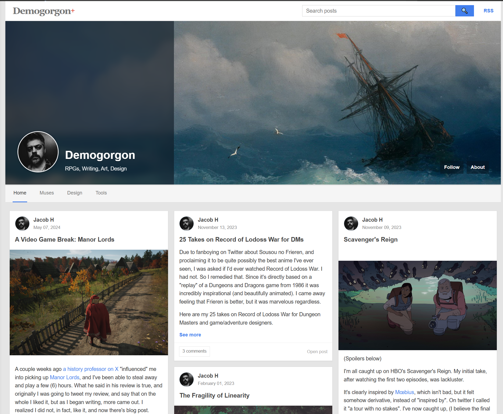
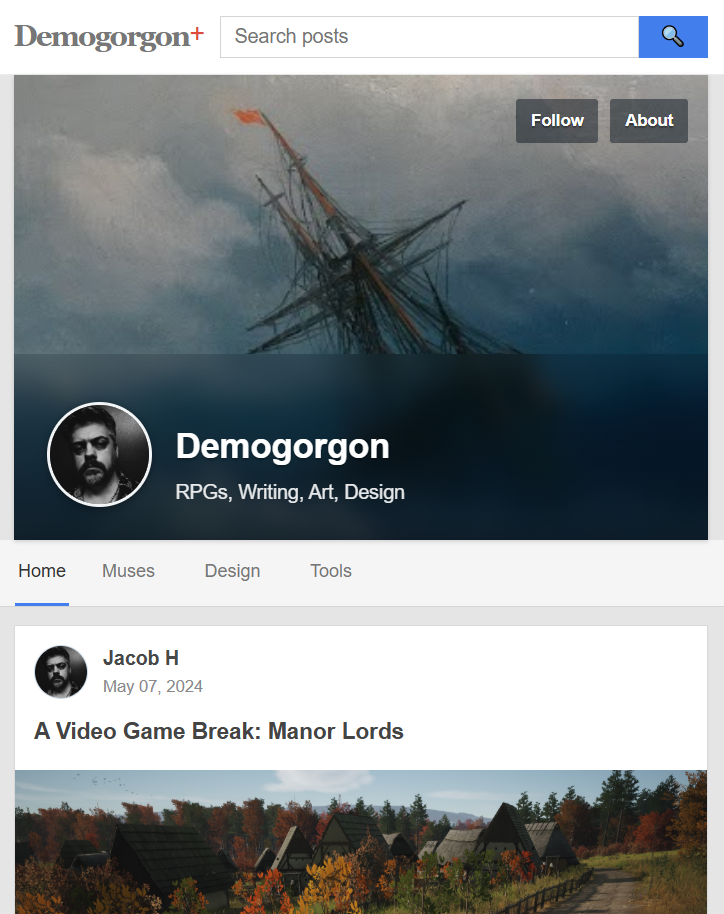
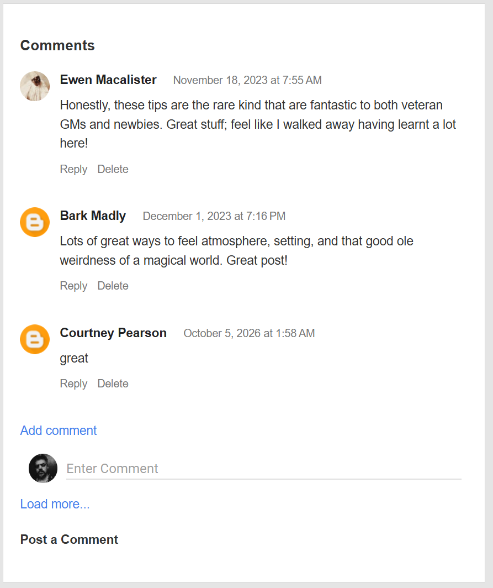

# PlusWall

**A Google+ inspired theme for [Blogger](https://www.blogger.com/)**, built around a responsive wall of posts, author profiles, and a configurable cover banner.

*Screenshots from a working development installation. Blog posts, profile pictures, and artwork are examples, not assets bundled with the theme.*

## Features

- Responsive, multi-column post wall with full-width images and natural-height cards.
- Native Blogger **jump breaks** for controlling how much of a post appears in the wall, with a *See more* link.
- Individual post pages with Blogger's built-in threaded comments and reply controls.
- Cover banner configured through Blogger's **Header** gadget, with title, description, and profile photograph.
- Contributor avatars sourced from their Blogger profiles, with no blog-specific image overrides.
- Navigation managed with Blogger's native **Link List** gadget; a Home link is generated automatically.
- Search, labels, post permalinks, and standard Blogger pagination.

### Mobile and comments

*These screenshots document the theme during development. The final 1.0 theme includes a 2 px outline around the banner profile photo.*

## Download

Download **[`PlusWall_1.0.xml`](PlusWall_1.0.xml)** from this repository, or get the XML file from the latest [GitHub release](../../releases/latest) once a release is published.

The XML is the Blogger theme. The screenshot files and Markdown documentation are not needed for installation.

## Install

1. In **Blogger → Theme**, back up your existing theme first using the theme menu's **Backup** option.
2. In the same menu, select **Restore** and upload `PlusWall_1.0.xml`.
3. Open **Blogger → Layout → Header**. Set your cover image and select **Behind title and description**.
4. Under **Layout → About Me**, enable/configure the Blogger Profile gadget and make sure your Blogger profile has a photo. This supplies the main profile image; individual posts use their authors' profile images.
5. Open **Layout → Navigation Links → Edit** to manage the Link List entries. **Home** is automatic, so you do not need to add it. To link to a label, use its label URL, for example `/search/label/Art`.
6. Check the home page, an individual post, comments, labels, and the mobile layout before retiring your previous theme.

**Important:** Blogger stores some gadget settings in the theme XML. Reinstalling or upgrading a theme may change the Header and Link List settings. Always keep a backup of a working installation before replacing the theme.

## Writing posts

Write posts in Blogger as usual. Use the native **Insert jump break** control in the post editor to choose where the wall preview stops. On an individual post page the full post appears.

Blogger's Theme Preview can behave differently from a published page, particularly with jump breaks. Verify on a published test post if a preview looks wrong.

## Compatibility and limitations

- Designed for **Blogger / Blogspot**. It is not a standalone website theme or a WordPress theme.
- Uses Blogger's native widget and comment infrastructure; deletion and moderation permissions remain under Blogger's control.
- Tested on working Blogger installations, with local checks of the release XML. Appearance can vary with post content, gadget settings, and Blogger changes.
- The public release contains **no Swordfish Islands author-image override** or other personalized blog settings.

## Origins, attribution, and license

PlusWall was developed by customizing and substantially restyling Google's **Blogger Emporio** theme. The original Blogger widget framework and portions of the widget markup remain. PlusWall is an **unofficial** theme, not made by or affiliated with Google.

The original PlusWall contributions are offered under the **MIT License**, to the extent the contributors hold copyright or other rights to license them. See [`LICENSE`](LICENSE). This is **not** a blanket claim of ownership or an MIT license for Google's inherited Blogger code.

The XML also includes **Normalize.css 3.0.1**, licensed under MIT by Nicolas Gallagher and Jonathan Neal. See [`THIRD_PARTY_NOTICES.md`](THIRD_PARTY_NOTICES.md) and [`licenses/normalize.css-MIT.txt`](licenses/normalize.css-MIT.txt).

The original Emporio code's separate redistribution terms have not been independently verified. The included credits and limited-scope MIT grant should not be interpreted as resolving that question.

## Contributing

If you find a bug, open a GitHub issue with the Blogger page type (home, label, or individual post), the expected behavior, and a screenshot or reproducible example. For changes to the theme, test Blogger's native widgets and comments before submitting them.
